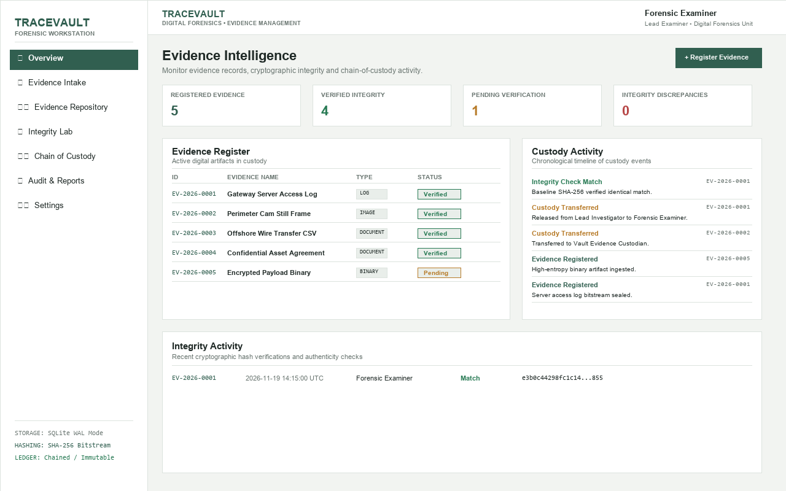
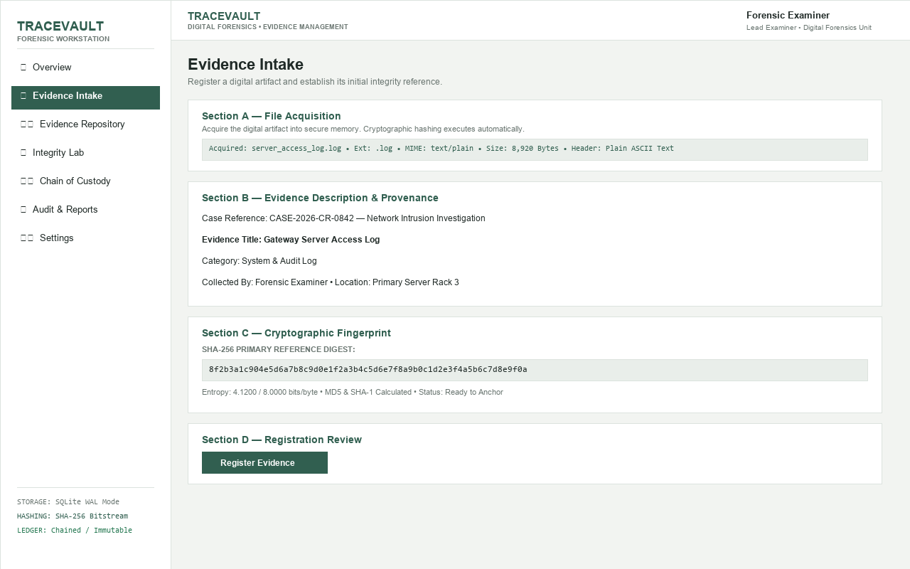
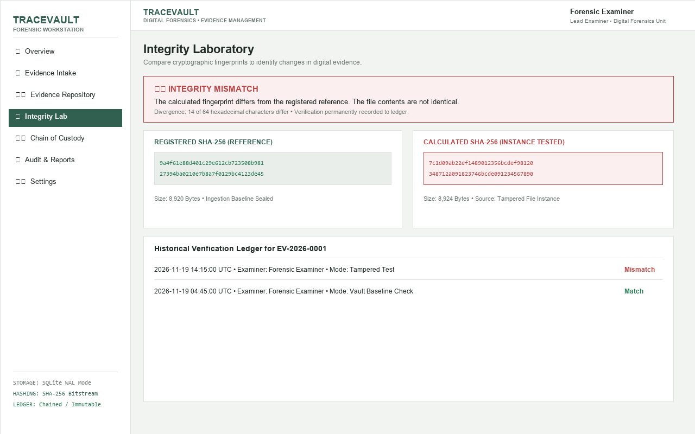
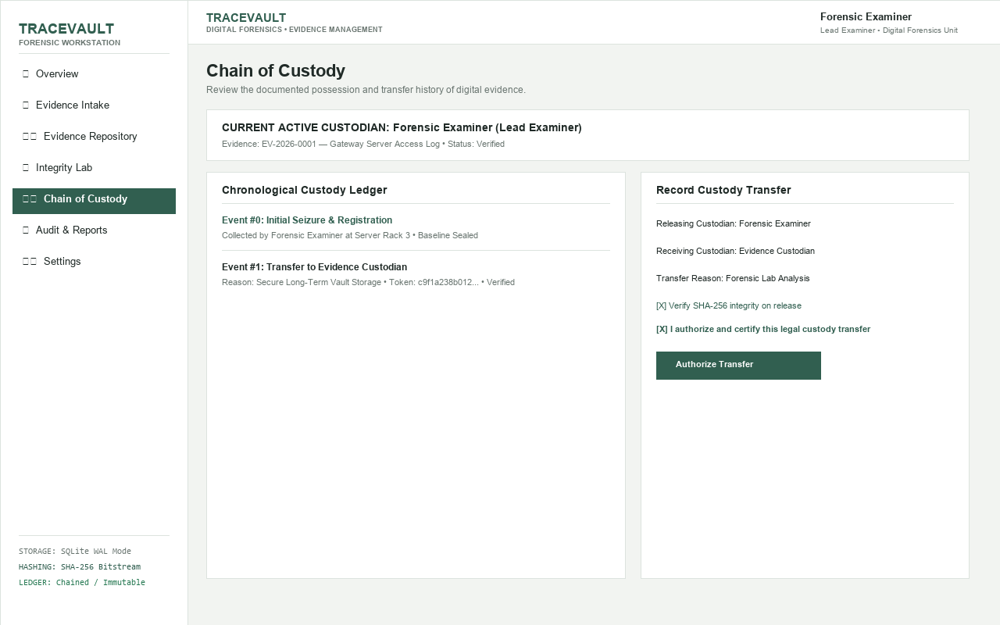

# TRACEVAULT — Digital Evidence Integrity & Chain-of-Custody Management System

[](tests/)
[](https://www.python.org/)
[](https://streamlit.io/)
[](https://www.sqlite.org/)
[](LICENSE)

TRACEVAULT is an intermediate digital forensics workstation built in Python and Streamlit. It records digital evidence artifacts, computes multi-algorithm cryptographic digests, extracts deep container and binary metadata, detects tampering via constant-time hash comparisons, logs custody transfers with verifiable digital receipt tokens, and maintains a cryptographically chained activity ledger.

---

## 1. Problem Statement & Motivation
Digital evidence such as server logs, disk images, surveillance camera recordings, and financial spreadsheets can be modified, corrupted, or transferred between examiners without documentation. Establishing bitstream authenticity and proving continuity of custody in court or compliance audits requires mathematical certainty and tamper-evident record keeping.

TRACEVAULT solves this problem by providing an air-gapped forensic workstation that computes deterministic SHA-256 baseline hashes at intake, alerts examiners on bit alterations, tracks custodial handovers, and chains audit events sequentially.

---

## 2. Creative Concept: The Forensic Evidence Workbench
TRACEVAULT combines three design influences into one coherent, professional workstation:
1. **Forensic Laboratory:** Structured layouts, precise technical metadata, evidence references, and verification logs.
2. **Digital Evidence Archive:** Professional archival aesthetic with organized registers, case references, and chronological ledgers.
3. **Cryptographic Workstation:** SHA-256 hashes, verification comparisons, and file fingerprints presented in technical monospace panels.

### Color System & Visual Identity
| Element | Hex Code | Purpose |
|---|---|---|
| Main Background | `#F2F4F1` | Calm, neutral workstation background |
| Primary Surface | `#FFFFFF` | Core panels and evidence cards |
| Secondary Surface | `#E9EEEA` | Supporting technical panels & data containers |
| Primary Text | `#202A27` | High-contrast readable typography |
| Secondary Text | `#697570` | Supporting captions and metadata labels |
| Deep Forest Accent | `#315F50` | Primary actions and active navigation |
| Muted Sage | `#91AA9D` | Subtle borders and secondary accents |
| Technical Accent | `#527C78` | Monospace labels and cryptographic badges |
| Border Color | `#DCE3DE` | Clean, thin 1px neutral framing |
| Verified Status | `#287A54` | Cryptographic match & confirmed integrity |
| Pending Status | `#B77B29` | Pending verification or in-transit custody |
| Integrity Discrepancy | `#B74747` | Bitstream alteration or hash mismatch alert |

---

## 3. Workstation Pages & Workflows

1. **Overview (Evidence Intelligence):** Command desk displaying key metrics (Registered Evidence, Verified Integrity, Pending Verification, Integrity Discrepancies), active evidence register, and chronological custody activity timeline.
2. **Evidence Intake:** Controlled 4-step acquisition workflow (File Acquisition, Evidence Description, Cryptographic Fingerprint, and Review & Registration).
3. **Evidence Repository:** Central archive inventory with multi-criteria search (Case, Category, Status) and textual file-type badges (`IMAGE`, `DOCUMENT`, `VIDEO`, `LOG`, `ARCHIVE`, `BINARY`).
4. **Integrity Lab:** Signature cryptographic comparison workspace featuring side-by-side reference vs. instance hash inspection, character-level divergence detection, and permanent verification logging.
5. **Chain of Custody:** Immutable chronological ledger of possession, transfer reasons, and cryptographic receipt tokens.
6. **Audit & Documentation:** Publication-grade PDF certificate generator via ReportLab, markdown reports, case manifests (CSV/JSON), and full activity logs.
7. **Settings:** Cryptographic audit chain integrity validator, examiner profile switcher, storage telemetry, and demo database reset.

---

## 4. Workstation Screenshots

### 4.1 Evidence Intelligence Overview

*Figure 1: Evidence Intelligence command desk displaying summary metrics, recent evidence register, and custody stream.*

### 4.2 Evidence Intake Workflow

*Figure 2: Controlled intake sequence with binary header inspection, Shannon entropy analysis, and baseline SHA-256 anchoring.*

### 4.3 Integrity Laboratory (Tampering Mismatch)

*Figure 3: Side-by-side cryptographic hash comparison displaying an Integrity Mismatch alert and divergence details.*

### 4.4 Chain of Custody Timeline Ledger

*Figure 4: Chronological custody transfer timeline, active legal custodian card, and certified handover authorization form.*

---

## 5. Architecture & Data Flow

```
[ Evidence Ingestion ] ---> [ Metadata & Magic Byte Inspector ]
                                       |
                                       v
                           [ Streaming Crypto Engine ]
                         (SHA-256 / MD5 / SHA-1 / Entropy)
                                       |
                                       v
                          [ SQLite WAL Database Layer ]
                    (evidence, custody_logs, audit_logs)
                                       |
                     +-----------------+-----------------+
                     |                                   |
                     v                                   v
          [ Integrity Verification ]         [ ReportLab PDF Generator ]
          (Constant-time digest match)      (Certified Custody Reports)
```

---

## 6. Technology Stack
- **Frontend / Workstation UI:** Streamlit (v1.66+) with custom CSS design system
- **Backend Core:** Python 3.11 / 3.12
- **Cryptographic Hashing:** `hashlib` (SHA-256, MD5, SHA-1), `hmac` (constant-time digest comparison)
- **Metadata Extraction:** Binary header signature table, `mimetypes`, `Pillow` (image geometry & EXIF)
- **Database:** SQLite with Write-Ahead Logging (WAL) and foreign keys enabled
- **Reporting Engine:** ReportLab (v5.1+)
- **Data Processing:** Pandas (v2.3+)
- **Testing:** Pytest (v8.4+)

---

## 7. Directory Structure
```
90-days-90-projects-day-26-tracevault/
├── app.py                     # Main Streamlit workstation entrypoint
├── requirements.txt           # Python dependency specification
├── setup.bat                  # Automated Windows installation script
├── run.bat                    # Workstation execution script
├── test.bat                   # Automated pytest runner
├── QUICKSTART.md              # 2-minute quick setup instructions
├── DEMO_SCRIPT.md             # 90-second interview demo guide
├── LICENSE                    # MIT permissive license
├── .env.example               # Configuration template
├── tracevault/
│   ├── database.py            # SQLite schema, queries, and connection manager
│   ├── core/
│   │   ├── crypto_engine.py       # Streaming hashing & entropy calculation
│   │   ├── metadata_inspector.py  # Binary headers, MIME, and text analysis
│   │   ├── forensic_analyzer.py   # Heuristic classification & risk scoring
│   │   ├── custody_manager.py     # Custody transfer ledger & receipts
│   │   ├── audit_engine.py        # Chained tamper-evident activity logging
│   │   └── report_generator.py    # ReportLab PDF certificate compiler
│   └── ui/
│       ├── styles.py          # Professional visual design system CSS
│       ├── components.py      # Reusable cards, badges, and hash formatters
│       ├── page_overview.py   # Overview dashboard
│       ├── page_register.py   # Evidence registration workflow
│       ├── page_repository.py # Searchable evidence inventory
│       ├── page_details.py    # Deep metadata & identity workspace
│       ├── page_verify.py     # Integrity verification engine
│       ├── page_custody.py    # Chain of custody timeline & transfers
│       ├── page_reports.py    # Official PDF & CSV report export
│       └── page_settings.py   # Audit chain validator & system status
├── data/
│   ├── sample_evidence/       # Realistic synthetic test exhibits
│   └── vault_storage/         # Stored bitstream copies of evidence
├── docs/                      # Technical documentation & architecture guides
├── screenshots/               # UI demonstration captures
├── scripts/
│   ├── seed_demo_data.py      # Database populator with test exhibits
│   └── generate_sample_evidence.py # Synthetic artifact generator
└── tests/                     # 21 unit and end-to-end integration tests
```

---

## 8. Prerequisites
- Windows 10 or 11 (64-bit)
- Python 3.11 or 3.12 installed and added to system PATH
- Web browser (Chrome, Edge, Firefox)

---

## 9. Installation & Windows Setup

### Option A: Automated Batch Script (Recommended)
```cmd
setup.bat
```
This script validates Python, creates the `.venv` virtual environment, installs dependencies, initializes the database, and seeds demo evidence files.

### Option B: Manual Command Line Setup
```cmd
:: 1. Create and activate virtual environment
python -m venv .venv
call .venv\Scripts\activate.bat

:: 2. Install dependencies
pip install -r requirements.txt

:: 3. Seed demonstration database
python scripts\seed_demo_data.py
```

---

## 10. Execution
To launch the workstation:
```cmd
run.bat
```
Or manually:
```cmd
.\.venv\Scripts\streamlit.exe run app.py --server.port 8501
```
Access the application in your browser at `http://localhost:8501`.

---

## 11. Automated Testing & Verification
Execute the test suite via the provided batch runner:
```cmd
test.bat
```
Or run pytest directly:
```cmd
.\.venv\Scripts\python.exe -m pytest tests -v
```

### Test Coverage Results
```
tests/test_audit_engine.py::test_audit_chain_sequential_integrity PASSED
tests/test_audit_engine.py::test_audit_chain_tamper_detection PASSED
tests/test_crypto_engine.py::test_hash_calculation_known_vectors PASSED
tests/test_crypto_engine.py::test_streaming_hash_calculation PASSED
tests/test_crypto_engine.py::test_constant_time_verification PASSED
tests/test_crypto_engine.py::test_shannon_entropy PASSED
tests/test_crypto_engine.py::test_audit_block_hash PASSED
tests/test_crypto_engine.py::test_custody_transfer_token PASSED
tests/test_database_and_custody.py::test_add_and_get_evidence PASSED
tests/test_database_and_custody.py::test_duplicate_hash_detection PASSED
tests/test_database_and_custody.py::test_custody_transfer_workflow PASSED
tests/test_e2e_forensic_workflow.py::test_complete_evidence_forensic_lifecycle PASSED
tests/test_forensic_analyzer.py::test_classify_evidence PASSED
tests/test_forensic_analyzer.py::test_interpret_entropy PASSED
tests/test_forensic_analyzer.py::test_evaluate_risk PASSED
tests/test_forensic_analyzer.py::test_generate_evidence_summary PASSED
tests/test_metadata_inspector.py::test_format_bytes PASSED
tests/test_metadata_inspector.py::test_magic_signature_detection PASSED
tests/test_metadata_inspector.py::test_mime_spoofing_detection PASSED
tests/test_metadata_inspector.py::test_text_forensic_metrics PASSED
tests/test_report_generator.py::test_generate_pdf_certificate PASSED

============================= 21 passed in 0.62s =============================
```

---

## 12. Security & Forensics Considerations
- **Hash Limitation Note:** A cryptographic SHA-256 hash mathematically proves whether file bits match a previously recorded state; it does not independently verify the physical identity of the author or whether the recorded events occurred in reality.
- **Audit Ledger Protection:** Retroactive database edits break the chained block hash sequence ($\text{SHA256}(\text{prev\_hash} + \text{data})$), allowing the built-in validator to identify modified rows.
- **Air-Gapped Operation:** All hashing, metadata parsing, and report generation execute locally without transmitting evidence across networks.

---

## 13. Future Enhancements
- Hardware Security Module (HSM) and smartcard X.509 digital report signing.
- Distributed Merkle tree sync across secondary custody stations.
- Automated sector-by-sector hexadecimal difference visualizer for tampered disk sectors.

---

## 14. Skills & Resume Keywords
- **Domains:** Cybersecurity, Digital Forensics, Security Engineering, Audit Trail Architecture
- **Keywords:** SHA-256, Cryptographic Hashing, File Integrity Verification, Chain of Custody, SQLite WAL, ReportLab, Streamlit, Shannon Entropy, Constant-Time Comparison, Python

---

## 15. License
Distributed under the MIT License. See [LICENSE](LICENSE) for details.
