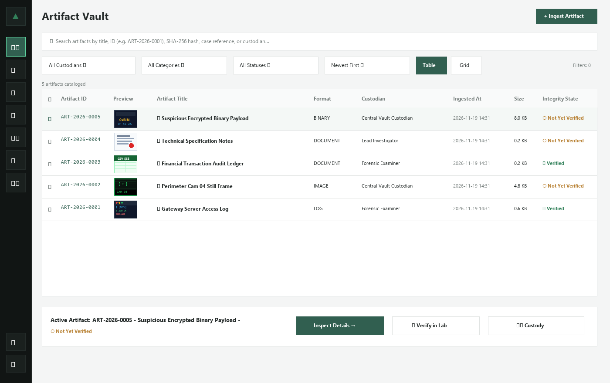
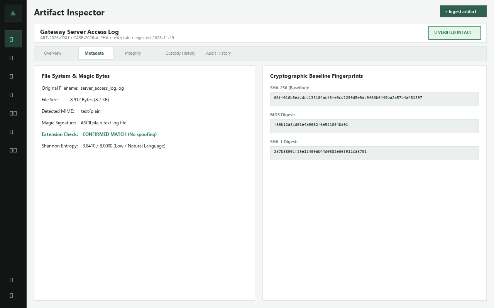
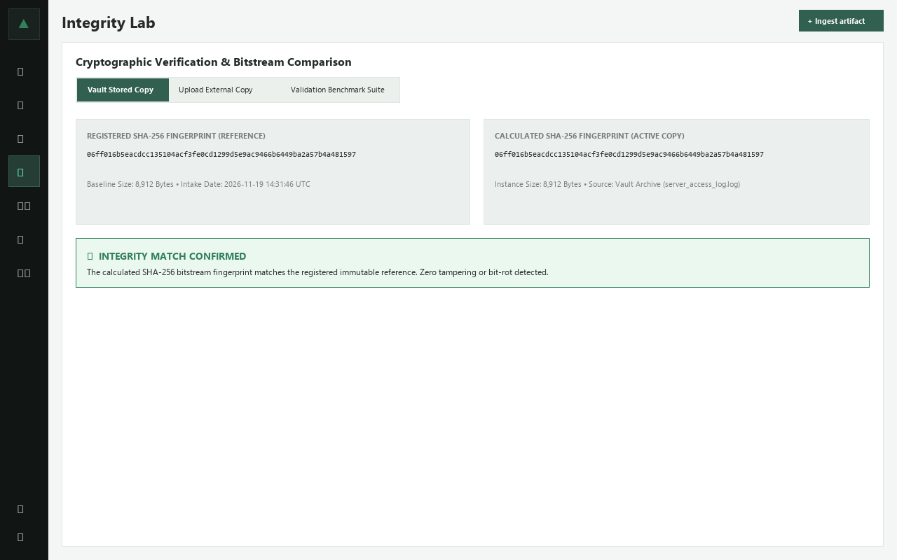
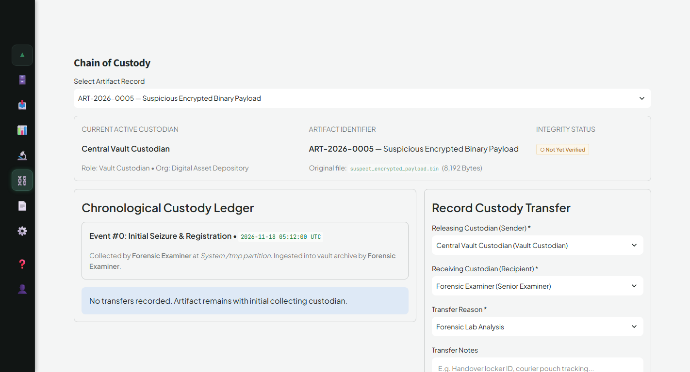

# KUSTODRA — Digital Asset Management System

[](tests/)
[](https://www.python.org/)
[](https://streamlit.io/)
[](https://www.sqlite.org/)
[](LICENSE)

> **DIGITAL ASSETS • FORENSIC INTEGRITY • CUSTODY MANAGEMENT**  
> *Every artifact. Every transfer. Every verification. Documented.*

**KUSTODRA** is an enterprise-grade digital asset custody workstation and forensic integrity verification platform built in Python and Streamlit. Designed for forensic examiners, compliance auditors, and digital asset custodians, KUSTODRA records digital artifacts and exhibits, computes multi-algorithm cryptographic digests (SHA-256, MD5, SHA-1), analyzes Shannon bitstream entropy, detects bit tampering via constant-time verification, tracks custodial handovers with cryptographic tokens, and maintains an immutable sequentially chained audit ledger.

---

## 1. Problem Statement & Mission

Digital artifacts and exhibits—such as gateway access logs, surveillance camera stills, financial ledgers, and forensic disk images—are highly vulnerable to silent tampering, bit corruption, unauthorized transfers, or procedural mishandling. In judicial proceedings and regulatory audits, establishing bitstream authenticity and proving an unbroken chain of custody requires cryptographic certainty and tamper-evident documentation.

**KUSTODRA** eliminates procedural ambiguity by providing an air-gapped custody workstation that:
- Establishes immutable cryptographic baselines at the exact moment of intake.
- Evaluates file formats via binary magic byte signatures and Shannon entropy metrics.
- Enforces chain-of-custody transfers with verified digital authorization receipts.
- Detects bit-level tampering through constant-time SHA-256 comparisons.
- Secures system events in a cryptographically chained SQLite WAL ledger ($\text{SHA256}(\text{prev\_hash} + \text{event\_data})$).
- Generates court-ready, certified PDF custody documentation via ReportLab.

---

## 2. Interface Design System & Visual Architecture

KUSTODRA features an enterprise asset management user interface modeled after forensic law enforcement systems:

- **Narrow Vertical Navigation Rail (~70px):** Ultra-compact dark charcoal rail (`#111514`) with a geometric delta mark (`▲`), single-icon navigation glyphs with tooltips, and green active indicator containers (`#263D36` / `#365C50`).
- **Clean Horizontal Page Header:** Features clear title hierarchy, domain breadcrumb (`KUSTODRA • ARTIFACT VAULT`), active examiner identity pill, and prominent `+ Ingest Artifact` call-to-action.
- **Wide Prominent Search Bar:** Full-width search bar with multi-field search capabilities across artifact titles, IDs, hashes, case numbers, and custodians.
- **Compact Filter Toolbar:** Multi-criteria filter strip featuring active filter count badge (`Filters (X)`), ID filter, Owner selector, Category filter, Status dropdown, Sort options, and Table/Grid switcher.
- **Dense Enterprise Artifact Table (Primary Screen):** High-density data grid with selection checkboxes, monospace artifact IDs (`ART-2026-XXXX`), format badges (`📄`, `📷`, `🎬`, `🔒`, `💾`), titles, custodians, recorded timestamps, file sizes, base64 image thumbnail previews (`st.column_config.ImageColumn`), and integrity status badges.

### Color Palette

| Element | Hex Code | Visual Role |
|---|---|---|
| Main Background | `#F4F5F5` | Neutral, high-legibility enterprise canvas |
| Navigation Rail | `#111514` | Ultra-dark charcoal vertical rail |
| Primary Surface | `#FFFFFF` | Core panels and artifact data cards |
| Secondary Surface | `#EBEFED` | Technical metadata containers and table headers |
| Primary Text | `#252B2A` | High-contrast dark charcoal typography |
| Secondary Text | `#777F7D` | Technical captions and metadata labels |
| Primary Accent | `#315F50` | Deep pine green for buttons and primary actions |
| Active Rail State | `#263D36` | High-contrast container for active rail navigation |
| Active Highlight | `#5ED49F` | Bright mint green active icon glyph |
| Border Separator | `#E1E4E3` | Thin 1px neutral framing borders |
| Verified Status | `#32815A` | Cryptographic match & confirmed integrity |
| Pending Status | `#B78032` | In-transit or pending laboratory verification |
| Integrity Discrepancy | `#BC4B4B` | Bitstream alteration alert & hash divergence |

---

## 3. Workstation Pages & Workflows

1. **Artifact Vault (Primary Landing Screen):** Enterprise artifact grid with full-width search, multi-criteria filtering, thumbnail previews, and interactive row selection.
2. **Intake & Ingestion:** Controlled 4-step intake sequence (File Acquisition & Magic Header Inspection, Artifact Description & Case Reference, Cryptographic Fingerprint Generation, and Review & Seal into KUSTODRA Vault).
3. **System Intelligence (Overview):** Command desk displaying key metrics (Cataloged Artifacts, Verified Integrity, Pending Verification, Integrity Discrepancies), active register, and custody stream.
4. **Artifact Inspector:** Comprehensive 5-tab inspector (Overview, Metadata, Integrity, Custody History, Audit History) with raw binary hex previews and Shannon entropy graphs.
5. **Integrity Lab:** Dedicated cryptographic comparison laboratory featuring side-by-side reference vs. instance hash inspection, nibble-level mismatch location, and permanent verification logging.
6. **Chain of Custody:** Immutable chronological ledger of possession, transfer reasons, and cryptographic receipt tokens.
7. **Audit & Compliance:** Publication-grade PDF certificate generator via ReportLab, markdown reports, case manifests (CSV/JSON), and full activity logs.
8. **System Configuration:** Cryptographic audit chain integrity validator, examiner profile switcher, storage telemetry, and baseline benchmark restore.

---

## 4. Workstation Screenshots

### 4.1 Enterprise Artifact Vault (Primary Screen)

*Figure 1: Enterprise Artifact Vault featuring the narrow vertical navigation rail, prominent search bar, compact filter toolbar with active count, and dense artifact grid with image thumbnail previews.*

### 4.2 Structured Artifact Inspector

*Figure 2: Structured Artifact Inspector with identity strip, 5 interactive inspection tabs, cryptographic fingerprints, and automated forensic classification.*

### 4.3 Integrity Laboratory (Tampering Mismatch)

*Figure 3: Side-by-side cryptographic comparison in the Integrity Lab displaying an Integrity Mismatch alert and divergent hexadecimal nibbles.*

### 4.4 Chain of Custody Timeline Ledger

*Figure 4: Chronological custody transfer timeline, active legal custodian card, and certified handover authorization form.*

---

## 5. System Architecture & Cryptographic Pipeline

```
[ Artifact Ingestion ] ---> [ Binary Magic Byte & MIME Inspector ]
                                           |
                                           v
                               [ Streaming Crypto Engine ]
                         (SHA-256 / MD5 / SHA-1 / Shannon Entropy)
                                           |
                                           v
                              [ SQLite WAL Database Layer ]
                        (evidence, custody_logs, audit_logs)
                                           |
                         +-----------------+-----------------+
                         |                                   |
                         v                                   v
             [ Integrity Lab Engine ]            [ ReportLab PDF Generator ]
             (Constant-time digest match)       (Certified Custody Reports)
```

---

## 6. Technology Stack

- **Frontend / Workstation UI:** Streamlit (v1.66+) with custom enterprise CSS design system
- **Backend Core:** Python 3.11 / 3.12
- **Cryptographic Hashing:** `hashlib` (SHA-256, MD5, SHA-1), `hmac` (constant-time digest comparison)
- **Metadata Extraction:** Binary header signature table, `mimetypes`, `Pillow` (image geometry & base64 thumbnails)
- **Database:** SQLite with Write-Ahead Logging (WAL) and foreign keys enabled
- **Reporting Engine:** ReportLab (v5.1+)
- **Data Processing:** Pandas (v2.3+)
- **Testing:** Pytest (v8.4+)

---

## 7. Directory Structure

```
90-days-90-projects-day-26-kustodra/
├── app.py                     # Main Streamlit workstation entrypoint
├── requirements.txt           # Python dependency specification
├── setup.bat                  # Automated Windows installation script
├── run.bat                    # Workstation execution script
├── run.ps1                    # PowerShell launcher script
├── test.bat                   # Automated pytest runner
├── QUICKSTART.md              # 2-minute quick setup instructions
├── DEMO_SCRIPT.md             # 90-second technical presentation guide
├── LICENSE                    # MIT permissive license
├── .env.example               # Configuration template
├── kustodra/
│   ├── database.py            # SQLite schema, queries, and connection manager
│   ├── core/
│   │   ├── crypto_engine.py       # Streaming hashing & entropy calculation
│   │   ├── metadata_inspector.py  # Binary headers, MIME, and text analysis
│   │   ├── forensic_analyzer.py   # Heuristic classification & risk scoring
│   │   ├── custody_manager.py     # Custody transfer ledger & receipts
│   │   ├── audit_engine.py        # Chained tamper-evident activity logging
│   │   └── report_generator.py    # ReportLab PDF certificate compiler
│   └── ui/
│       ├── styles.py          # Professional visual design system CSS
│       ├── components.py      # Reusable cards, badges, and hash formatters
│       ├── page_overview.py   # System Intelligence dashboard
│       ├── page_register.py   # Intake & Ingestion workflow
│       ├── page_repository.py # Enterprise Artifact Vault (Primary)
│       ├── page_details.py    # Structured artifact inspector
│       ├── page_verify.py     # Integrity verification laboratory
│       ├── page_custody.py    # Chain of custody timeline & transfers
│       ├── page_reports.py    # Official PDF & CSV report export
│       └── page_settings.py   # Audit chain validator & system status
├── data/
│   ├── sample_evidence/       # Realistic synthetic test exhibits
│   └── vault_storage/         # Stored bitstream copies of artifacts
├── docs/                      # Technical documentation & architecture guides
├── screenshots/               # High-resolution UI captures
├── scripts/
│   ├── seed_demo_data.py      # Baseline benchmark record generator
│   ├── generate_sample_evidence.py # Synthetic artifact generator
│   └── generate_screenshots.py # UI screenshot generator
└── tests/                     # 23 unit and end-to-end integration tests
```

---

## 8. Prerequisites & Installation

- Windows 10 or 11 (64-bit)
- Python 3.11 or 3.12 installed and added to system PATH
- Web browser (Chrome, Edge, Firefox)

### Option A: Automated Batch Script (Recommended)
```cmd
setup.bat
```
This script validates Python, creates the `.venv` virtual environment, installs dependencies, initializes the database, and seeds baseline benchmark files.

### Option B: Manual Command Line Setup
```cmd
:: 1. Create and activate virtual environment
python -m venv .venv
call .venv\Scripts\activate.bat

:: 2. Install dependencies
pip install -r requirements.txt

:: 3. Seed baseline database
python scripts\seed_demo_data.py
```

---

## 9. Launching the Workstation

To launch the workstation:
```cmd
run.bat
```
Or with PowerShell:
```powershell
.\run.ps1
```
Access the application in your browser at `http://localhost:8501`.

---

## 10. Automated Testing & Verification

Execute the test suite via the provided batch runner:
```cmd
test.bat
```
Or run pytest directly:
```cmd
.\.venv\Scripts\python.exe -m pytest tests -v
```

---

## 11. Legal & Forensic Notices

> **Cryptographic Integrity Scope:** A SHA-256 hash proves mathematically whether file contents match a previously recorded hash; it does not independently prove who created the file or whether the original artifact was authentic. Integrity is contingent on custody continuity, secure registry access, and tamper-evident audit logging.

---

## 12. License
Distributed under the MIT License. See [LICENSE](LICENSE) for details.
